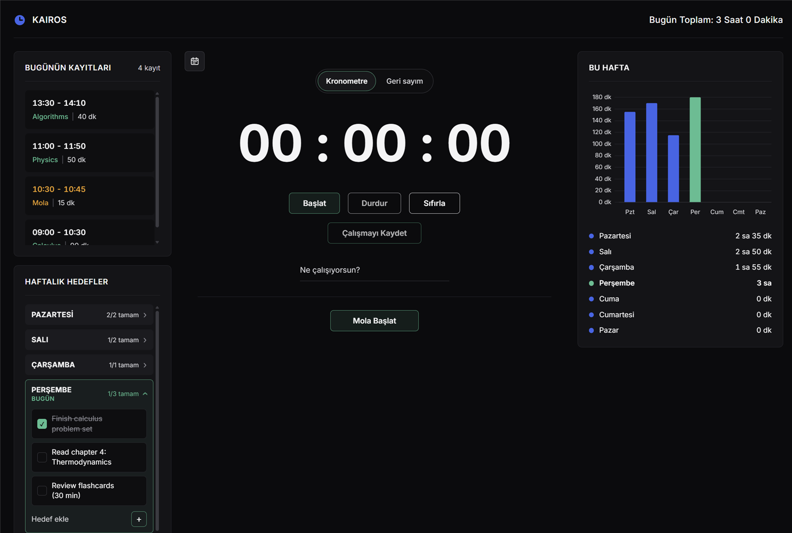
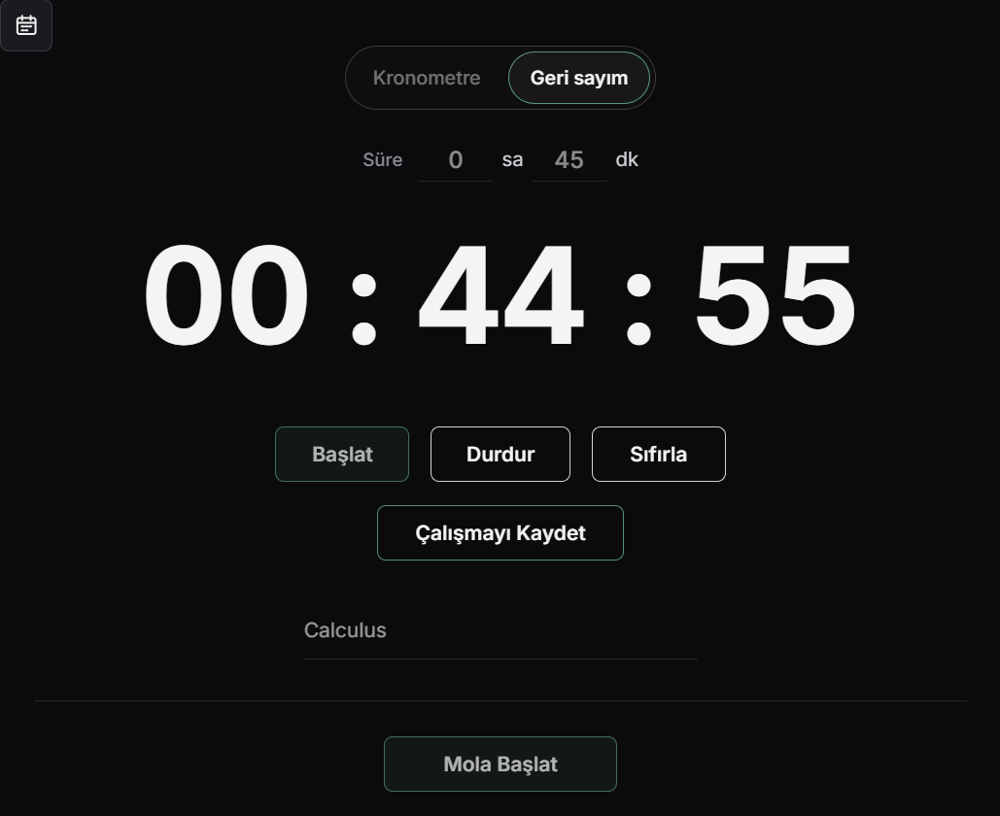
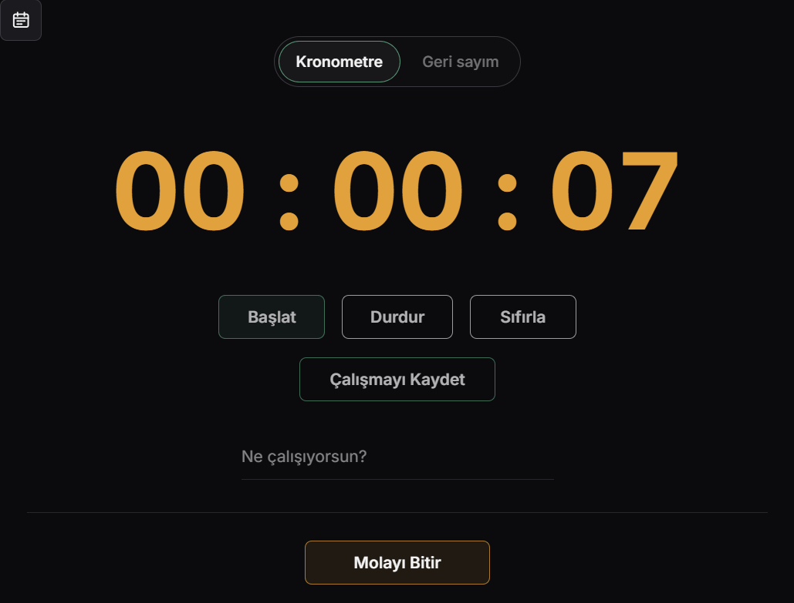
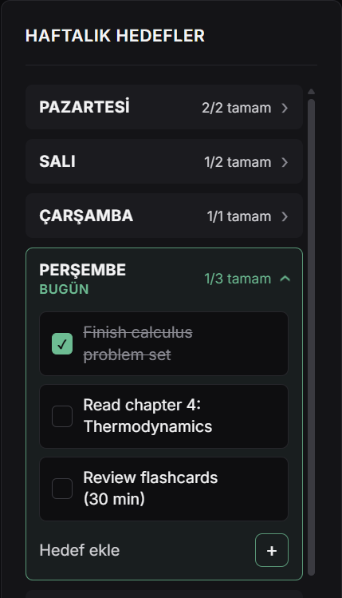
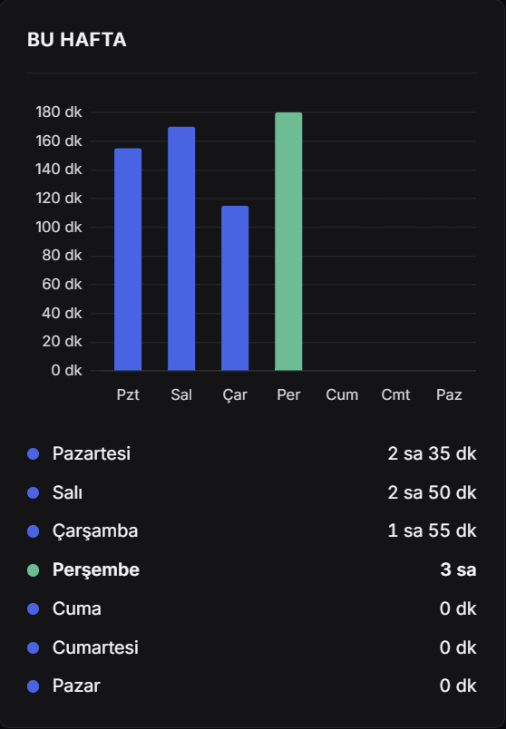
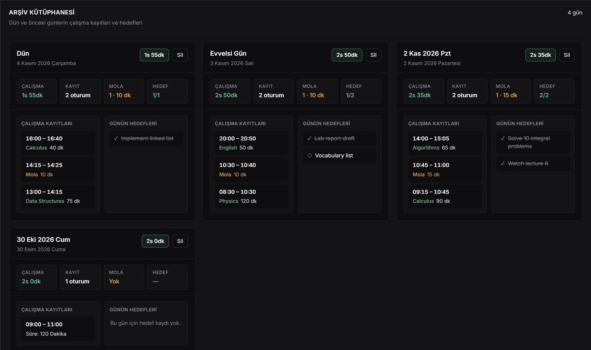
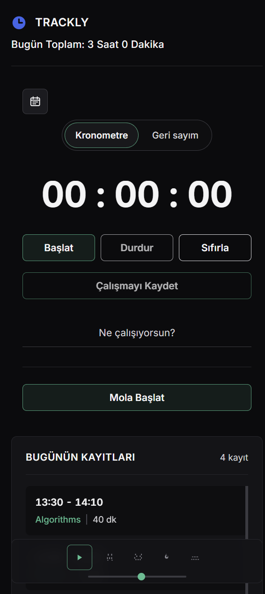

# Trackly — Odak ve Çalışma Takipçisi

> Odaklan, takip et, alışkanlık kazan.

Trackly, tamamen tarayıcıda çalışan sade ve dikkat dağıtmayan bir çalışma takipçisidir. Çalışmalarını kronometre veya geri sayımla tutabilir, mola verebilir, haftanın her günü için hedef belirleyebilir ve ilerlemeni haftalık grafikte görebilirsin. Geçmiş günler otomatik olarak arşivlenir.

**Canlı demo:** [furkaneneskum.github.io/trackly](https://furkaneneskum.github.io/trackly/)



---

## Özellikler

### Kronometre ve geri sayım

Süresiz çalışmalar için **kronometre**, belirli bir süre için ise saat ve dakika ayarlanabilen **geri sayım** modu vardır. Ne çalıştığını yazabilir (örneğin *Matematik*) ve tek tıkla çalışmayı günün kayıtlarına ekleyebilirsin. Geri sayım bittiğinde kısa bir uyarı sesi çalar.

<p align="center">
  
</p>

### Tek tuşla mola

Mola tek bir butondan yönetilir: **Mola Başlat**'a basınca ileri sayan bir mola başlar, sayaç turuncuya döner ve aynı buton **Molayı Bitir** olur. Bir dakikadan uzun molalar kayıtlara eklenir. Molalar çalışma süresinden ayrı tutulduğu için toplam çalışma süreni şişirmez.

<p align="center">
  
</p>

### Elle kayıt ekleme ve düzenleme

Kronometreyi açmayı unuttuysan çalışmanı sonradan ekleyebilirsin. "Bugünün Kayıtları" panelindeki **+ Ekle** butonu bir pencere açar. Burada tarih, başlangıç ve bitiş saati, tür (çalışma veya mola) ve ne çalıştığını girersin; süre otomatik hesaplanır. Gece yarısını geçen kayıtlar da (örneğin 23:30 – 00:45) doğru hesaplanır. Geçmiş bir tarih seçersen kayıt doğrudan o günün arşivine eklenir.

Bugünkü ve arşivdeki her kaydın yanındaki kalem ikonu aynı pencereyi düzenleme modunda açar. Saatleri, türü veya etiketi değiştirebilir ya da kaydı silebilirsin. Silinen kayıt çıkan bildirimden geri alınabilir.

### Haftalık hedef planlayıcı

Pazartesiden pazara her gün için ayrı hedefler belirleyebilirsin. Her gün açılıp kapanan bir panel olarak görünür ve ilerlemesini gösterir (örneğin *1/3 tamam*). Bugünün paneli otomatik açılır. Her günün içinde hedef ekleyebilir, tamamlandı olarak işaretleyebilir veya silebilirsin.

### Haftalık ilerleme grafiği

Chart.js ile hazırlanan çubuk grafik, bu hafta her gün kaç dakika çalıştığını gösterir. Bugün ayrı renkle vurgulanır, grafiğin altında da günlere göre toplam süreler listelenir.

<p align="center">
  
  &nbsp;&nbsp;
  
</p>

### Arşiv kütüphanesi

Gün değiştiğinde o günün çalışmaları, molaları ve hedefleri arşive taşınır. Her arşiv günü; toplam çalışma süresi, oturum sayısı, molalar ve tamamlanan hedeflerle birlikte bir kart olarak görünür. Kartın içinden o güne yeni kayıt ekleyebilir, mevcut kayıtları düzenleyebilirsin. Bir günü silebilir, yanlışlıkla sildiysen çıkan bildirimden geri alabilirsin.



### Odak sesleri

Ekranın köşesindeki küçük oynatıcıda odaklanmana yardımcı olacak ortam sesleri bulunur: hafif yağmur, sağanak yağmur, şömine ve lo-fi müzik. Ses seviyesi ayarlanabilir.

### Her ekrana uyumlu tasarım

Trackly masaüstünde üç sütun, tablette iki sütun, telefonda ise tek sütun halinde görünür. Hiçbir ekranda yatay kaydırma olmaz.

<p align="center">
  
</p>

---

## Kullanılan teknolojiler

| Katman | Teknoloji |
|--------|-----------|
| Yapı | Anlamsal HTML5, ARIA etiketleriyle erişilebilirlik |
| Tasarım | Saf CSS (CSS değişkenleri, Grid ve Flexbox, medya sorguları), Inter yazı tipi |
| Mantık | Saf JavaScript (ES2020+), framework ve derleme adımı yok |
| Grafik | CDN üzerinden [Chart.js 4](https://www.chartjs.org/) |
| Veri saklama | Tarayıcının `localStorage` alanı |
| Yayın | GitHub Pages |

## Nasıl çalışır?

- **Sunucu ve hesap gerekmez.** Tüm veriler tarayıcının `localStorage` alanında saklanır, hiçbir bilgi cihazından dışarı çıkmaz.
- **Sayfa yenilense de kaybolmaz.** Sayaç durumu sürekli kaydedilir. Çalışan kronometre, geri sayım veya mola sayfa yenilendiğinde kaldığı yerden devam eder; sekme arka plandayken de doğru süreyi tutar.
- **Otomatik gün geçişi.** Tarih değiştiğinde günün kayıtları ve hedefleri arşive taşınır, yeni gün boş başlar.
- **Kayıt anahtarları:**
  - `studyTrackerData`: günün kayıtları, çalışan sayacın durumu ve arşiv
  - `studyTracker_goals_YYYY-AA-GG`: belirli bir günün hedefleri
  - `calismaTakipcisi_settings`: sayaç modu ve geri sayım süresi

> Tarayıcının site verilerini temizlersen geçmişin silinir. Veriler her tarayıcıda ve her cihazda ayrı tutulur.

## Bilgisayarda çalıştırma

Trackly statik bir site olduğu için herhangi bir yerel web sunucusuyla çalışır:

```bash
git clone https://github.com/furkaneneskum/trackly.git
cd trackly
python -m http.server 8000
```

Ardından tarayıcıda <http://localhost:8000> adresini aç.

## Proje yapısı

```
├── index.html          # Sayfa yapısı
├── style.css           # Tasarım ve ekran uyumluluğu
├── script.js           # Sayaç, mola, hedefler, grafik, arşiv ve ses oynatıcı
├── audio/              # Odak sesleri
└── docs/screenshots/   # Bu README'deki ekran görüntüleri
```

---

Geliştiren: **Furkan Enes Kum**
